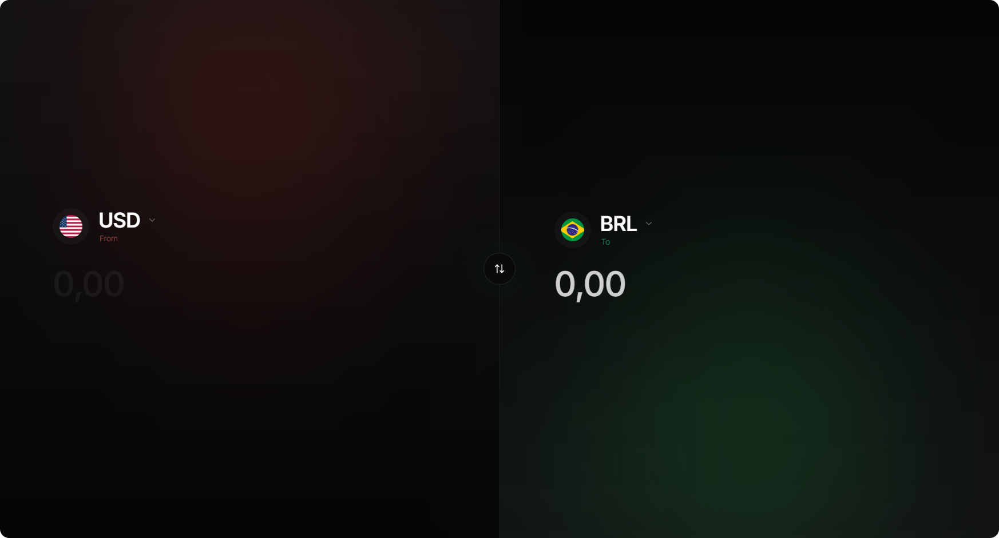

# FluxPair

A minimal, mobile-first currency converter for 10 fiat currencies and Bitcoin, with live rates, saved pairs and smooth animations.



## Features

- **Live rates** from [AwesomeAPI](https://docs.awesomeapi.com.br/), refreshed every minute while the tab is visible
- **11 currencies**: BRL, USD, EUR, GBP, JPY, CAD, AUD, ARS, CNY, CHF and Bitcoin (BTC)
- **Swap** source and target in one tap
- **Favorites and saved pairs**, stored in `localStorage` with your last active pair
- **Startup fallback**: a built-in rate snapshot renders the UI until the first successful fetch (approximate, not live)
- **English and Portuguese**, picked from your browser language, with locale-aware number formatting
- **Animated numbers** and transitions with Framer Motion
- Mobile-first layout with safe-area support

## Tech stack

| Layer | Technology |
| --- | --- |
| UI | React 19 + TypeScript |
| Build | Vite 7 |
| Styling | Tailwind CSS 3, clsx + tailwind-merge |
| Animation | Framer Motion |
| Icons | Lucide React |
| State | React Context |
| Data | AwesomeAPI (rates), flagcdn.com (flags), Wikimedia Commons (BTC icon) |

## Getting started

Requirements: Node.js 20+ (LTS) and Yarn 1.22.

```bash
yarn install
yarn dev
```

| Script | What it does |
| --- | --- |
| `yarn dev` | Start the Vite dev server |
| `yarn build` | Type-check and build for production |
| `yarn preview` | Serve the production build locally |
| `yarn lint` | Run ESLint |

No API key or `.env` is needed.

## Project structure

```text
src/
  components/   CurrencyConverter, CurrencyCard, CurrencySelector, CurrencyIcon, MotionNumber
  context/      CurrencyContext (rates, favorites, pairs), LanguageContext (en/pt)
  lib/          Currency list and helpers
public/         Favicon
```

## Disclaimer

Rates are for reference only. Don't use them for financial transactions.

## License

[MIT](LICENSE)

## Author

**Gustavo Soares**, designer and front-end developer at **GsStudio**

- Portfolio: [gustasoares.com](https://gustasoares.com)
- GitHub: [@hzguz](https://github.com/hzguz)
